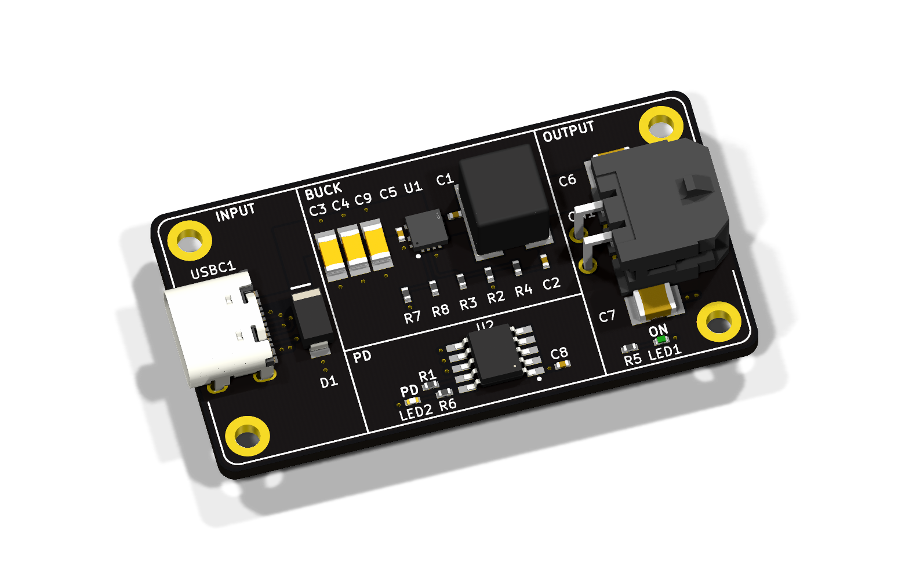

# Smart Blinds

Compact, rechargeable blind controllers for seven windows, with one spare.
White printed enclosures, USB-C charging, physical buttons and Home Assistant control.

[](https://github.com/0x63616c/smart-blinds/actions/workflows/design-previews.yml)

**Current stage: prototype design.** This repository is being designed afresh. The inherited
USB-C boards below are references, not the new blind controller or a battery charger.
No complete unit has been built or physically validated.

[Design brief](docs/brief.md) · [Progress](docs/status.md) · [Measurements](docs/measurements.json) ·
[Validation plan](docs/verification-plan.md) · [Shopping list](bom/README.md)

## The product

- One integrated controller and one 3S2P Samsung 50E battery pack per blind.
- Existing Recfountik JGB37-520 12 V / 111 RPM encoder motors.
- A small white enclosure mounted low on the wall, with accessible USB-C and up/down buttons.
- Group commands align the **physical bottom edges** of different-height blinds.
- A short remote-command preparation delay is acceptable; local controls respond immediately.
- 60 days between charges is the design target; 90 days is a stretch, pending measured power use.
- Compare at least three enclosure layouts before choosing the packaging and PCB outline.
- Optimize the total cost for eight units, including JLCPCB assembly fees, packs, fixings and wiring.

The first milestone is a complete, costed design for **two prototypes**. Two different-height
blinds are needed to test synchronization before committing to the eight-unit batch.

## Design gallery

These images are generated from the design sources. [Preview generation and provenance](docs/previews.md).
A green preview badge means the images generated successfully, not that the hardware is validated.

<!-- previews:start -->
### PD12V6Mini — inherited power-board reference

Existing e8s USB-C PD to 12.6 V power supply. This is not the new controller or a battery charger; no new hardware validation is implied.



[Source](hw/layouts/pd12v6mini/pd12v6mini.kicad_pcb) · [Generated files](docs/generated/pd12v6mini-reference/)

<!-- previews:end -->

New enclosure, assembly and controller previews will be added as their source designs exist.

## What's in the project

| Folder | Contents |
|---|---|
| `cad/` | Original packaging studies, enclosure sources and print/export instructions |
| `hw/` | Board sources, KiCad layouts, parts and simulation models |
| `firmware/` | Embedded control, calibration, safety state machine and tests |
| `integrations/` | Home Assistant coordination and integration as implemented |
| `bom/` | Per-unit, two-prototype and eight-unit cost/inventory records |
| `docs/` | Requirements, evidence, design comparisons and validation results |
| `tools/` | Reproducible documentation and preview generation |

## Development

The inherited electrical project uses atopile and KiCad 10. See [hardware instructions](hw/README.md).
The documentation renderer uses Python 3.11+ and KiCad 10; it reads layouts without regenerating them.

```sh
python3 tools/render_previews.py
```

CI renders registered sources on changes, uploads review artifacts for pull requests, and refreshes
committed previews on `main`. Source hashes and tool versions accompany the images. Print and
manufacturing releases must also pass the separate [validation gates](docs/verification-plan.md).

## Provenance

Created from private [e8s](https://github.com/0x63616c/e8s) at
`3ad0a29efcf933d6b887825998ced19d0c5ab11e`, preserving its history and working reference boards.
The original e8s repository is unchanged. Older Smart Shades, Smart Blinds and Packmule projects
are evidence sources only: [archive findings](docs/research/archive-findings.md).
Their architecture and completion claims do not carry forward into this design.
