# Smart Blinds

Compact, rechargeable blind controllers for seven windows, with one spare.
White printed enclosures, USB-C charging, physical buttons and Home Assistant control.

[](https://github.com/0x63616c/smart-blinds/actions/workflows/design-previews.yml)
[](https://github.com/0x63616c/smart-blinds/actions/workflows/design-checks.yml)

**Current stage: prototype design.** This repository is being designed afresh. The inherited
USB-C boards below are references, not the new blind controller or a battery charger.
No complete unit has been built or physically validated.

[Enclosure comparison](docs/mechanical/2026-10-19-holder-and-drive-trade-study.md) · [Electronics comparison](docs/electrical/2026-10-19-power-control-trade.md) ·
[Design brief](docs/brief.md) · [Progress](docs/status.md) · [Measurements](docs/measurements.json) ·
[Validation plan](docs/verification-plan.md) · [Shopping list](bom/README.md)

## The product

- One integrated controller and one 3S2P Samsung 50E battery pack per blind.
- PCB-mounted cell holders are being evaluated on a separate protected carrier to simplify assembly.
- Existing Recfountik JGB37-520 12 V / 111 RPM encoder motors.
- A small white enclosure mounted low on the wall, with accessible USB-C and up/down buttons.
- Group commands align the **physical bottom edges** of different-height blinds.
- A short remote-command preparation delay is acceptable; local controls respond immediately.
- 60 days between charges is the design target; 90 days is a stretch, pending measured power use.
- Compare at least three enclosure layouts before choosing the packaging and PCB outline.
- Optimize the total cost for eight units, including JLCPCB assembly fees, packs, fixings and wiring.

The first milestone is a complete, costed design for **two prototypes**. Two different-height
blinds are needed to test synchronization before committing to the eight-unit batch.

## Design gallery

These images are generated from the design sources. [Preview generation and provenance](docs/previews.md).
A green preview badge means the images generated successfully, not that the hardware is validated.

<!-- previews:start -->
### Holder carrier enclosure — provisional exterior

Original 170 × 158 × 64 mm packaging study using six PCB-mounted holders and an independent chain shaft. Retention, electrical layout and purchased-part fit are still in development.

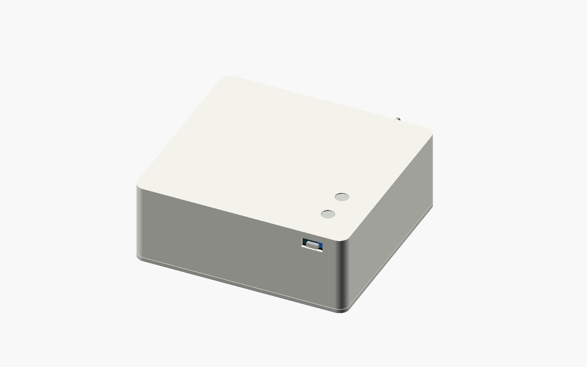

[Source](cad/source/packaging_v2.scad) · [Generated files](docs/generated/holder-closed/)

### Battery holders and supported drives, at the same scale

Six packaging reservations. The two welded-pack options remain size references; the holder alternatives compare assembly effort, width and depth.

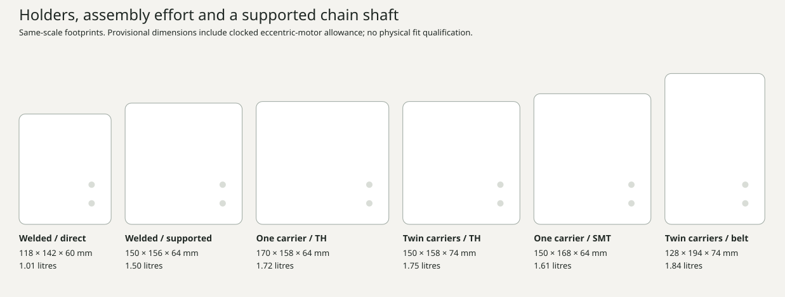

[Source](cad/parameters/packaging-v2.json) · [Generated files](docs/generated/holder-comparison/)

### Protected carrier and supported drive — exploded study

Original 170 × 158 × 64 mm packaging study using six PCB-mounted holders and an independent chain shaft. Retention, electrical layout and purchased-part fit are still in development.

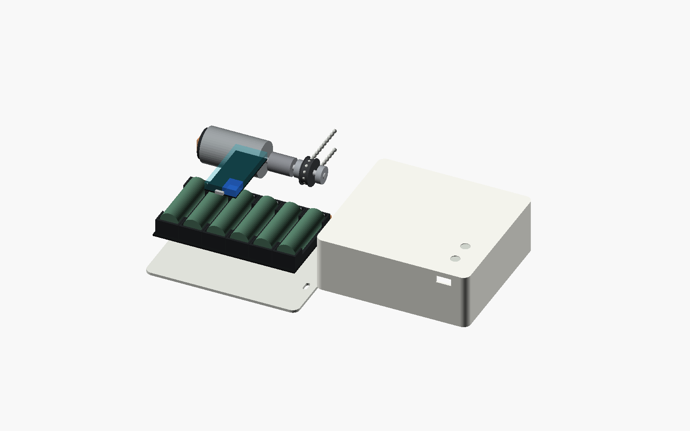

[Source](cad/source/packaging_v2.scad) · [Generated files](docs/generated/holder-exploded/)

<details>
<summary>One protected carrier — internal arrangement</summary>

Original 170 × 158 × 64 mm packaging study using six PCB-mounted holders and an independent chain shaft. Retention, electrical layout and purchased-part fit are still in development.

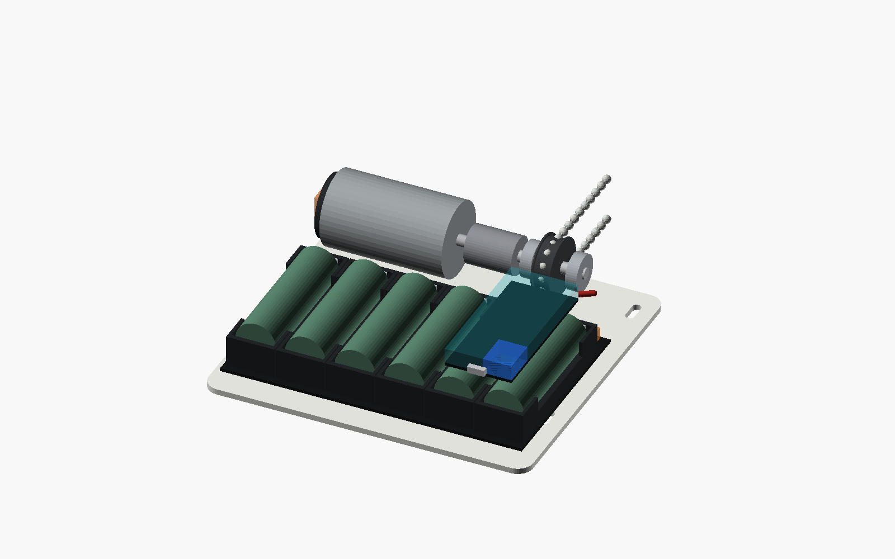

[Source](cad/source/packaging_v2.scad) · [Generated files](docs/generated/holder-inside/)

</details>

<details>
<summary>Motor driver — native KiCad circuit study</summary>

Fourteen components and 43 physical pin connections agree with the atopile board graph. This open block has four documented ERC boundary findings; supply, controller, motor connector and regenerative-energy clamp are not yet integrated.

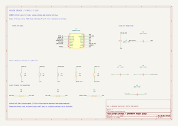

[Source](hw/schematics/blind-controller/motor-test.kicad_sch) · [Generated files](docs/generated/motor-schematic/)

</details>

<details>
<summary>Compact enclosure — provisional exterior</summary>

Earlier study, before PCB-mounted holders and independent shaft support. Initial compact direct-drive packaging candidate. Original parametric geometry; purchased-part fit and the holder-carrier alternative remain under review.

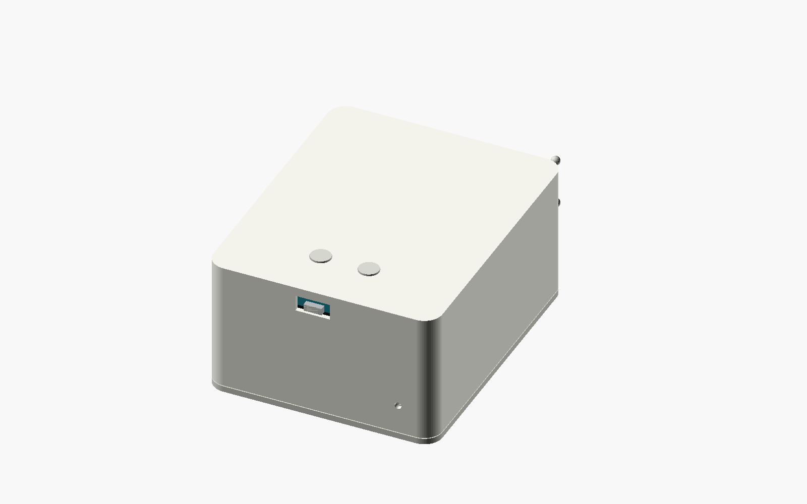

[Source](cad/source/smart_blinds.scad) · [Generated files](docs/generated/compact-closed/)

</details>

<details>
<summary>Four layouts at the same scale</summary>

Earlier study, before PCB-mounted holders and independent shaft support. Calculated front footprints from the original packaging study. Dimensions and purchased-part envelopes remain provisional.

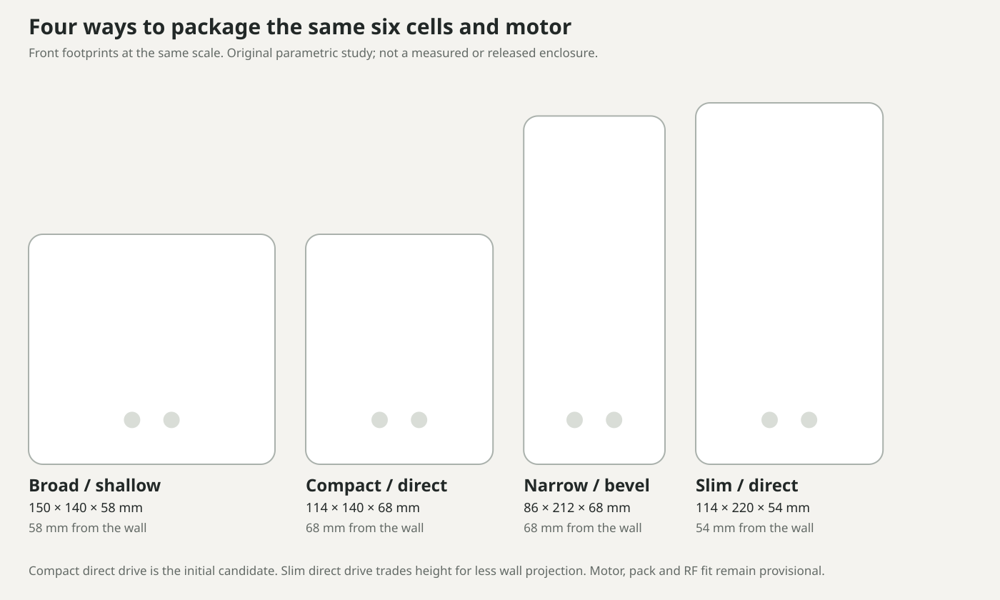

[Source](cad/parameters/packaging.json) · [Generated files](docs/generated/packaging-comparison/)

</details>

<details>
<summary>Compact enclosure — exploded study</summary>

Earlier study, before PCB-mounted holders and independent shaft support. Enclosure and internal fit study. Motor, cells and PCB are reserved envelopes; attachment and drive details are still being developed.

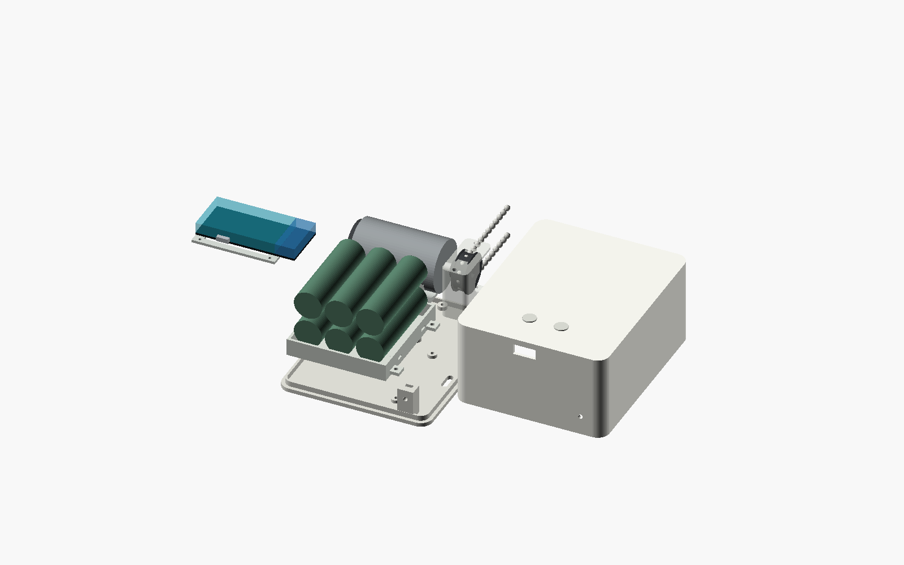

[Source](cad/source/smart_blinds.scad) · [Generated files](docs/generated/compact-exploded/)

</details>

<details>
<summary>Compact direct drive — packaging study</summary>

Earlier study, before PCB-mounted holders and independent shaft support. Compact direct drive with three cell columns and two depth layers. Provisional packaging study.

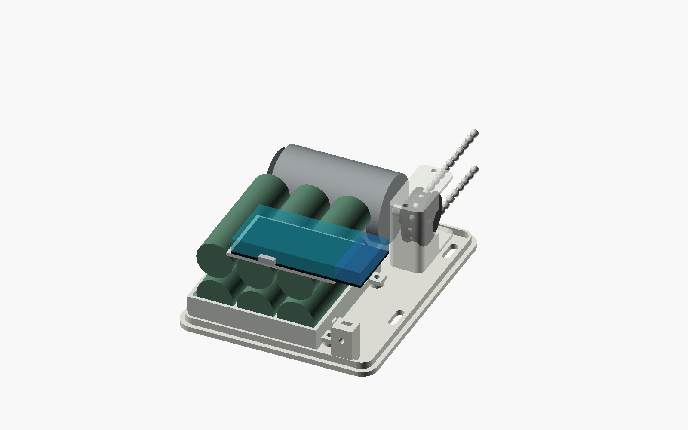

[Source](cad/source/smart_blinds.scad) · [Generated files](docs/generated/compact-assembly/)

</details>

<details>
<summary>Wide and shallow — packaging study</summary>

Earlier study, before PCB-mounted holders and independent shaft support. Six cells across one depth layer. Provisional packaging study.

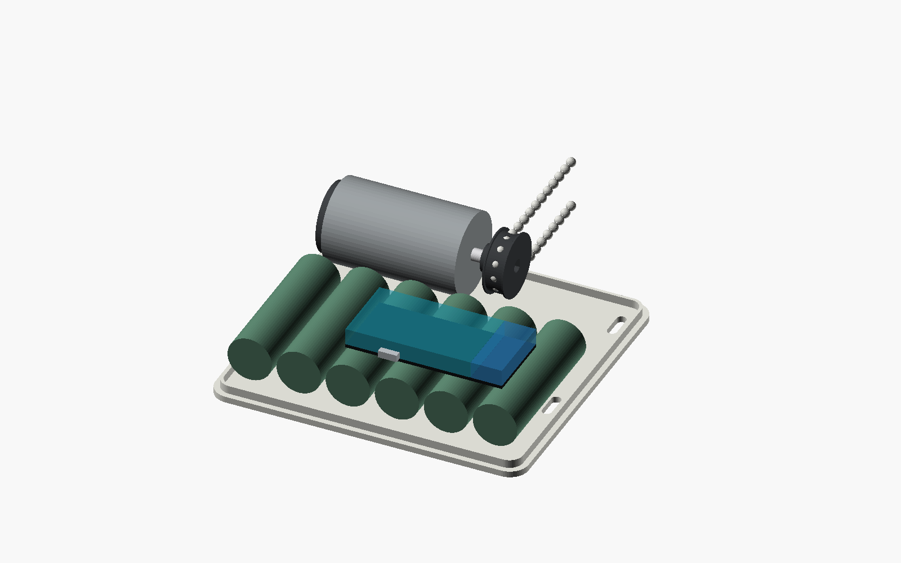

[Source](cad/source/smart_blinds.scad) · [Generated files](docs/generated/broad-assembly/)

</details>

<details>
<summary>Narrow with right-angle drive — packaging study</summary>

Earlier study, before PCB-mounted holders and independent shaft support. Narrow footprint with a right-angle transmission envelope. Gears are not yet functional designs.

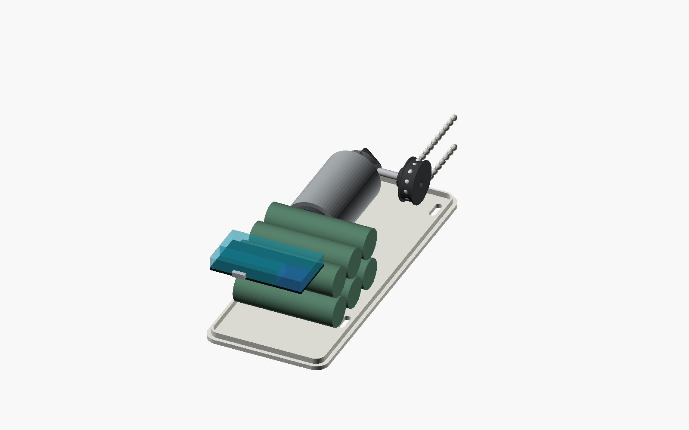

[Source](cad/source/smart_blinds.scad) · [Generated files](docs/generated/narrow-assembly/)

</details>

<details>
<summary>Tall and shallow direct drive — packaging study</summary>

Earlier study, before PCB-mounted holders and independent shaft support. Two vertical rows of three cells in a single depth layer. Provisional packaging study.

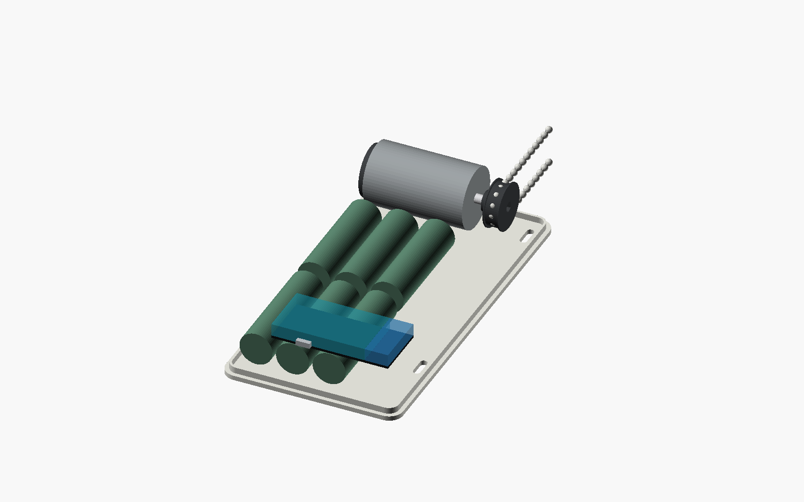

[Source](cad/source/smart_blinds.scad) · [Generated files](docs/generated/slim-assembly/)

</details>

<details>
<summary>PD12V6Mini — inherited power-board reference</summary>

Existing e8s USB-C PD to 12.6 V power supply. This is not the new controller or a battery charger; no new hardware validation is implied.


[Source](hw/layouts/pd12v6mini/pd12v6mini.kicad_pcb) · [Generated files](docs/generated/pd12v6mini-reference/)

</details>

<!-- previews:end -->

The enclosure views show original packaging studies with provisional motor and PCB envelopes.
The fresh integrated controller is still being designed; the inherited board is labelled separately.

## What's in the project

| Folder | Contents |
|---|---|
| `cad/` | Original packaging studies, enclosure sources and print/export instructions |
| `hw/` | Board sources, KiCad layouts, parts and simulation models |
| `firmware/` | Embedded control, calibration, safety state machine and tests |
| `integrations/` | Home Assistant coordination and integration as implemented |
| `bom/` | Per-unit, two-prototype and eight-unit cost/inventory records |
| `docs/` | Requirements, evidence, design comparisons and validation results |
| `tools/` | Reproducible documentation and preview generation |

## Development

The inherited electrical project uses atopile and KiCad 10. See [hardware instructions](hw/README.md).
The documentation renderer uses Python 3.11+ and KiCad 10; it reads layouts without regenerating them.

```sh
python3 tools/render_previews.py
```

CI renders registered sources on changes, uploads review artifacts for pull requests, and refreshes
committed previews on `main`. Source hashes and tool versions accompany the images. Print and
manufacturing releases must also pass the separate [validation gates](docs/verification-plan.md).

## Provenance

Created from private [e8s](https://github.com/0x63616c/e8s) at
`3ad0a29efcf933d6b887825998ced19d0c5ab11e`, preserving its history and working reference boards.
The original e8s repository is unchanged. Older Smart Shades, Smart Blinds and Packmule projects
are evidence sources only: [archive findings](docs/research/archive-findings.md).
Their architecture and completion claims do not carry forward into this design.
