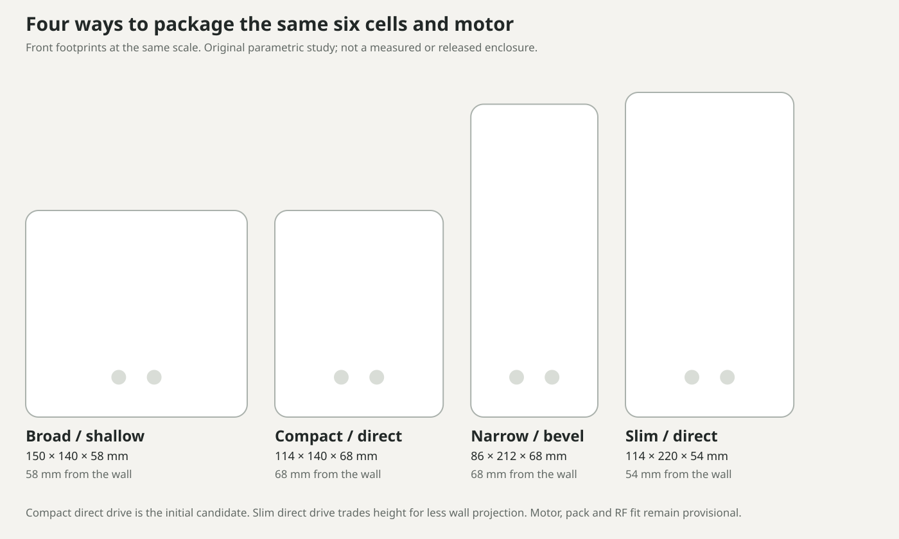
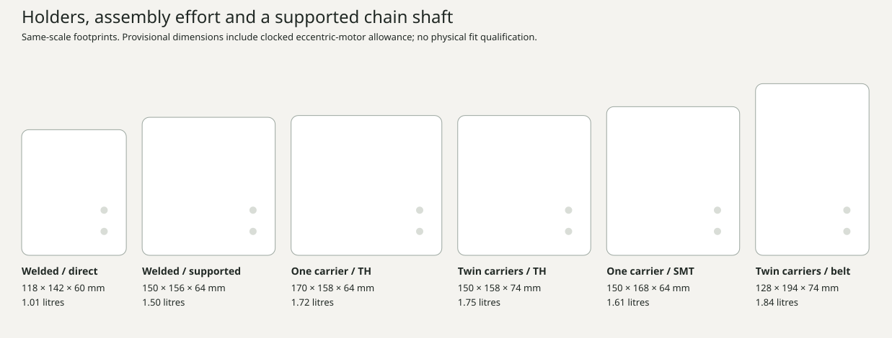

# Mechanical design

Original parametric CAD for the new Smart Blinds project. Prior project models were not reused. **These are packaging studies and provisional fit parts, not released functional or battery assemblies.**




The current direction is the [PCB-holder and supported-drive comparison](../docs/mechanical/2026-10-19-holder-and-drive-trade-study.md). It includes a35×75mm side-board arrangement, actual holder dimensions, a supported chain shaft and a parallel-belt alternative. The original compact recommendation below has been superseded; no enclosure is frozen.



Compare the [four initial complete layouts](../docs/mechanical/2026-10-19-packaging-trade-study.md). The compact direct-drive candidate was **114 × 140 × 68 mm** in that first study. Six cells and the unmeasured motor dominate size; making the electronics a little smaller will not remove that volume.

- [Editable CAD](source/smart_blinds.scad)
- [Dimension and evidence inputs](parameters/packaging.json)
- [Calculated checks](generated/verification.json)
- [Assembly and qualification notes](../docs/mechanical/assembly-and-fit.md)
- [Mechanical shopping quantities](../bom/mechanical.md)

## Regenerate

Requires Python 3 and OpenSCAD 2021.01 or later. Python uses only its standard library.

```sh
python3 cad/build.py --parameters-only
python3 cad/build.py --check-parameters
python3 cad/build.py --render --export
```

For a single view:

```sh
openscad -o compact.png --preview --autocenter --viewall --imgsize=1400,1400 \
  -D 'option="compact"' -D 'part="assembly"' cad/source/smart_blinds.scad
```

Options: `broad`, `compact`, `narrow`, `slim`. Views: `assembly`, `closed`, `exploded`. Individual fit parts: `base`, `cover`, `cradle`, `clamp`, `wheel`, `guard`, `pcb_tray`, `button`, `coupons`. The broad/narrow/slim configurations are only whole-product envelope studies; individual fit parts are developed for compact only.

The exporter hashes its inputs before work and refuses to publish verification if they change during generation. The coupon sheet must have eight separate objects; every individual candidate mesh must be one closed connected shell. These checks do not prove that an assembly works.

The generated SCAD parameter include is checked in so generic OpenSCAD renders work. Edit the JSON and regenerate it; do not edit the include. STL outputs are generated into `cad/exports/provisional/` and remain ignored by the repository. CI should publish them as prototype artifacts only when explicitly requested, with the qualification status attached.

## What the colors mean

White/grey parts are printable geometry. Green cylinders are cell envelopes. Silver cylinders are provisional motor/shaft envelopes. The black rectangle is the reserved PCB outline; cyan is component clearance, blue is an antenna reservation. Those are not fabricated PCB/component models. The right-angle study shows gear envelopes rather than cut gear teeth.

The body has no oversized branding or section labels. The two flush buttons, underside USB-C opening and a small underside retention screw are the intended visible controls. The plastic material, wall fasteners, chain guards, heat resistance and long-term creep still need physical qualification.

## Holder and drive study

Source: [packaging_v2.scad](source/packaging_v2.scad). Inputs: [packaging-v2.json](parameters/packaging-v2.json). Evidence: [holder-verification.json](generated/holder-verification.json).

```sh
python3 cad/build_v2.py --parameters-only
python3 cad/build_v2.py --check-parameters
python3 cad/build_v2.py --render
```

Options: `sidecar`, `supported`, `holders_broad`, `holders_stack`, `holders_smt`, `holders_belt`. Views: `assembly`, `closed`, `exploded`, `drive`, `holder_carrier`. These are integrated packaging reservations, not yet a complete printable product. Carrier retention, motor clamps, bearing housings, guard, cover fasteners and button plungers are the next detailed CAD pass. The local PNGs are ignored; CI can render the same source into the central gallery.

The source records loaded holder height as an allowance; no current or thermal rating is inferred from a catalog listing. Orange shows the protection-electronics or motor-cable reservation. A12mm gap between twin-carrier backs includes a1mm insulating barrier. New parts must meet the [material and load-path requirements](../docs/mechanical/material-and-retention.md).
