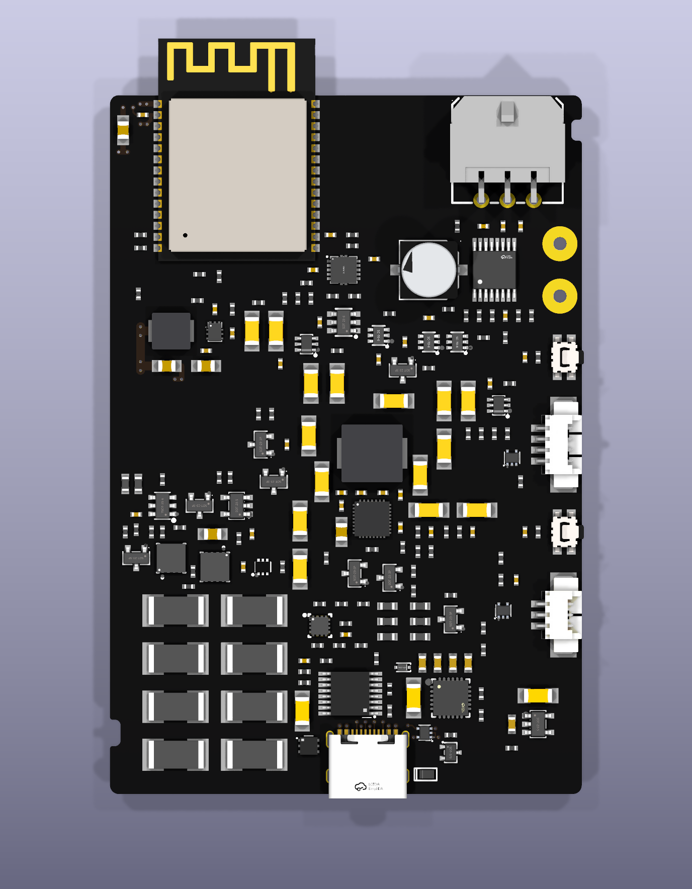
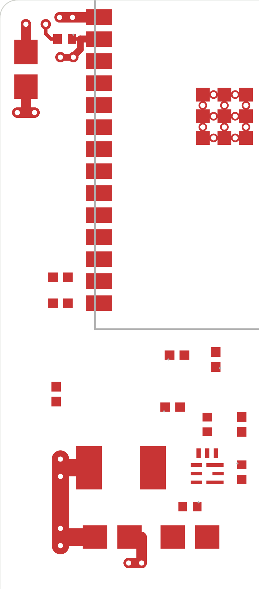
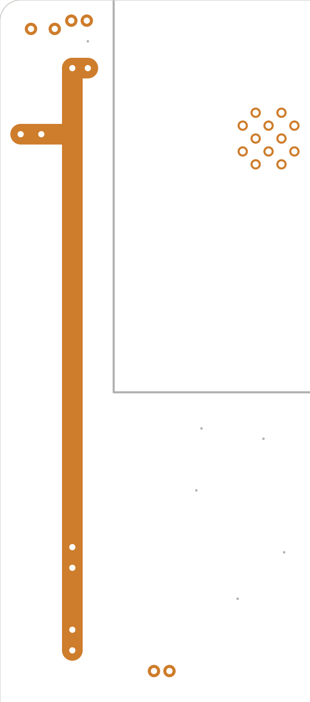
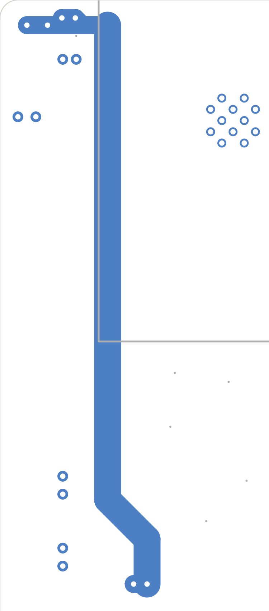
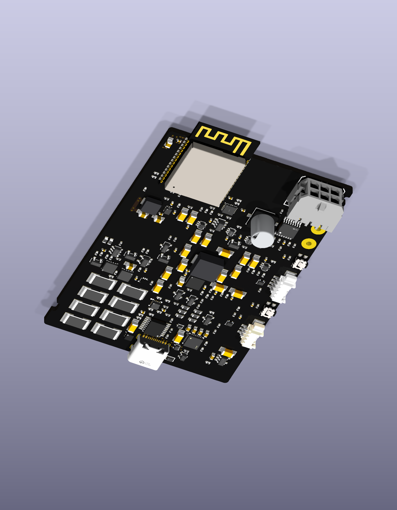

# Cleaner markings and local controller supply

The latest **54 × 80 mm, four-layer working candidate** retains all 206 parts.
It adds a dedicated controller power feed, moves two existing capacitors beside
the controller and removes the remaining printed-outline clashes. This is a
partial route, with **470 unconnected items**; it is not ready to fabricate.

## What changed

The existing 22 µF and 0.1 µF capacitors move beside the controller's supply pin.
Their positive-pad distances fall from 21.70 and 20.27 mm to 5.06 and 1.58 mm.
These are geometric distances, not measured electrical performance. No part or
assembly SKU is added. Short top-layer connections reach the pads; a 1 mm wide
inner-layer feed carries power along the left edge, with an explicit 1.5 mm
bottom-layer ground return. Four pairs of ordinary vias join the supply layers.

The changes add 30 segments and 14 vias to the earlier USB routing, for totals
of 65 segments and 28 vias. The power and ground paths connect the listed
inductor/output-capacitor and controller terminals by actual intersecting copper;
the check does not assume that unfilled ground planes provide a connection.
The regulator's input, switch/feedback connections and further ground connections
are still unfinished, so this does not establish a working supply circuit.

Printed outlines on the inductors, buttons, two transistors and battery connector
are corrected. Native KiCad now reports no silkscreen-clearance findings. The
review also restores eight copper keepouts beneath the signal connectors'
plastic feet. Their existing hold-down lands touch the keepout boundaries at
eight locations without positive-area overlap; no manufacturing tolerance is
claimed at those tangencies. Repeated child identifiers are made unique while
preserving the component and circuit identities.

## Actual layer views

These cropped views use native KiCad geometry. Only the SVG viewport changes.
The red top layer has short pad entries; the orange inner layer carries the long
feed. The blue bottom return runs beside it. There are no copper pours yet.

| Top copper | Inner supply | Bottom return |
| --- | --- | --- |
|  |  |  |

## Verification and remaining tradeoffs

The [saved-file audit](v10-actual-geometry.json) checks the actual native board:
0.25 mm component origins, 0.05 mm route vertices, 45°/90° routing, terminal-only
top-layer body entry, foreign-copper clearance, drill-to-land spacing, physical
continuity and the eight restored keepouts. Eleven deliberately broken copies
are rejected. The parent independently verified 74 source/evidence hashes and
reran the geometry analysis without changing the frozen evidence.

Native DRC finds no copper-clearance, courtyard, silkscreen or keepout violations.
It retains **470 unconnected items, eight dangling vias, three library comparisons
and three hybrid footprint-type findings**. Two library comparisons concern the
connectors' board-level versus footprint-local keepout representation. The third
exposed a real supervisor footprint discrepancy against its package drawing;
that correction is being developed separately. None is silently waived.

The two supply capacitors have a narrow prototype exception to the project's
conservative antenna-surround reservation. The antenna itself remains clear;
the metal-cell, motor, screw and harness restrictions remain. The exact capacitor
placement is not manufacturer-approved. Module voltage during radio/motor/charge
activity and radio performance inside the loaded enclosure need physical tests.
The [Espressif layout guidance](https://docs.espressif.com/projects/esp-hardware-design-guidelines/en/latest/esp32c6/pcb-layout-design.html)
informed this trade, rather than proving the exact arrangement.

Actual native top, oblique and three layer views were inspected. Reference-plane
fills, the rest of the routing, USB/CC protection review, enclosure fit and
electrical/thermal qualification remain open. The [checkpoint](v10-checkpoint.json)
binds these frozen review images to their local working sources. The canonical
board and its automatic gallery have not yet been replaced.

