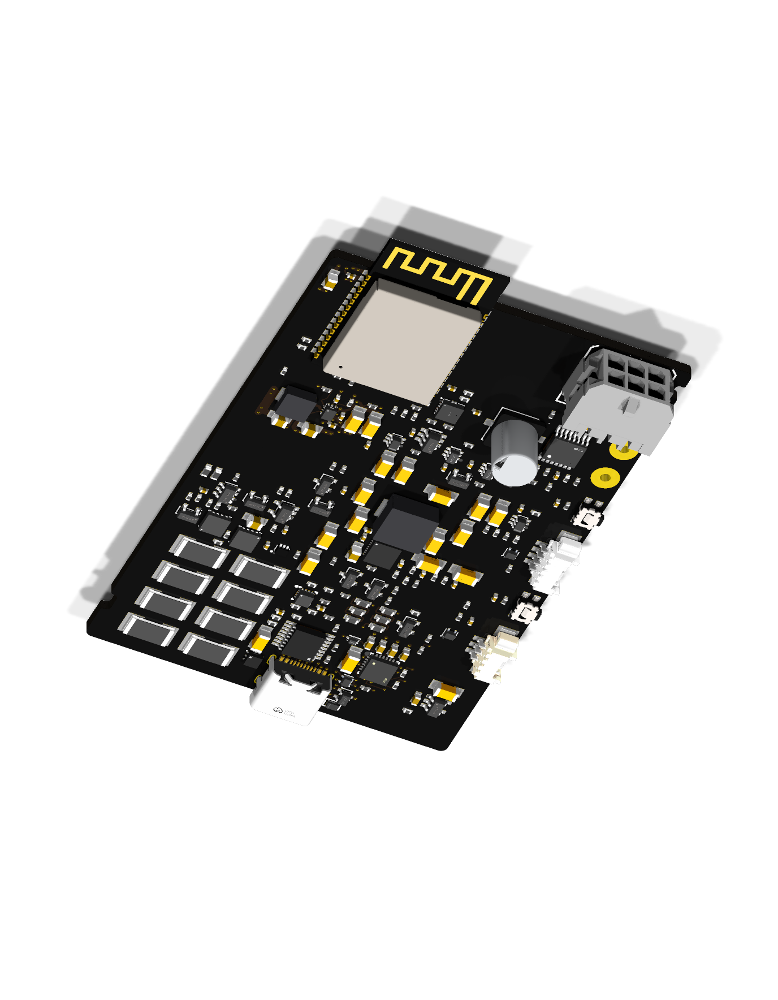

# USB-C routing and the current editable controller

The [working KiCad project](../../../hw/studies/clean-main/) is now in the
repository, with its local footprints and all 204 model attachments resolved.
The normal preview workflow renders this source when it changes. It remains a
54 × 80 mm, four-layer **partial design with 417 open connections**.

The v16 import includes the improved local regulator copper, USB-C PD bypass,
configuration and discharge routing, plus two refinements from electrical review:

- Both CC lines pass through their actual protection-diode lands. Removing a
  clamp land from the connectivity analysis disconnects the socket from the PD
  controller; there is no remote-via shortcut around the land.
- A real, connected 82.326397 mm² inner-layer ground island reaches the four
  bypass-capacitor ground vias and the PD ground via. Its saved copper contains
  the four direct return corridors credited in the layout comparison.

The final refinement changes no component, pose, model or selected supplier part.
The complete draft has 206 footprints, 297 segments and 70 vias. Component
origins remain on the 0.25 mm grid, with right-angle rotations; routed traces use
horizontal, vertical or 45° segments. Own-pad entries are narrowly reviewed,
including the required exposed ground pad, rather than exempting entire ICs
from the top-body routing rule.

## Evidence and limits

The board was filled, saved and reopened in isolated Linux KiCad 10.0.7. An
independent saved-file geometry check verified the new paths, finite copper,
previous 18 local connection groups and unchanged component metadata. Seventeen
deliberately broken copies of the actual native result were rejected, including
a clamp bypass, a detached same-net island and loss of a newly credited return
corridor while the old ground path remained connected. Native top, oblique and
all four USB-C copper-layer views were inspected.

Native DRC retains 417 open connections, six dangling vias, two library comparison
findings and three hybrid-footprint findings. It adds no clearance, short,
courtyard, silkscreen or keepout findings. These observations are recorded in
[the imported review](../../../hw/studies/clean-main/review.json); they are a
v16 checkpoint, not an automatic electrical acceptance of future edits.

The preview workflow verifies export and source/model provenance. It does not
replace routing review or electrical qualification. A continuous reference plane,
the remaining power and signal routes, thermal/transient analysis, complete
enclosure fit and powered prototype tests are unfinished. The older 196-part
canonical schematic is also awaiting reconciliation with this 206-part study.
No unit has been fabricated or powered. Do not order this board.

Earlier review snapshots remain available: [regulator routing](regulator-routing.md),
[USB data](usb-data-routing.md) and [the size comparison](../../trades/2026-10-21-cleaner-main-board.md).
