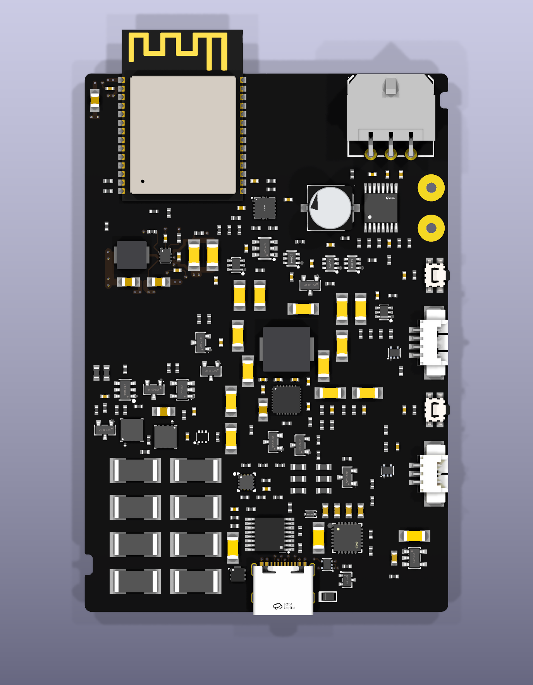
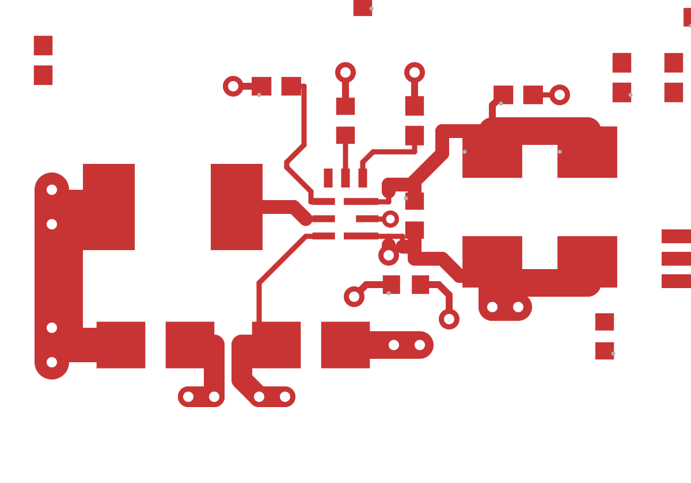
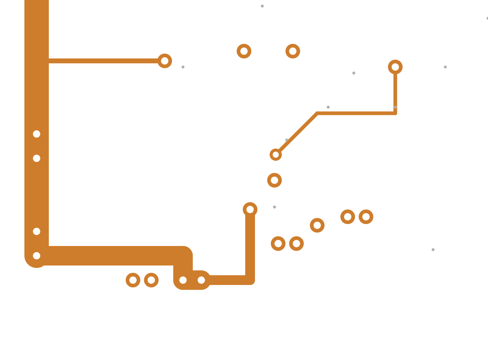
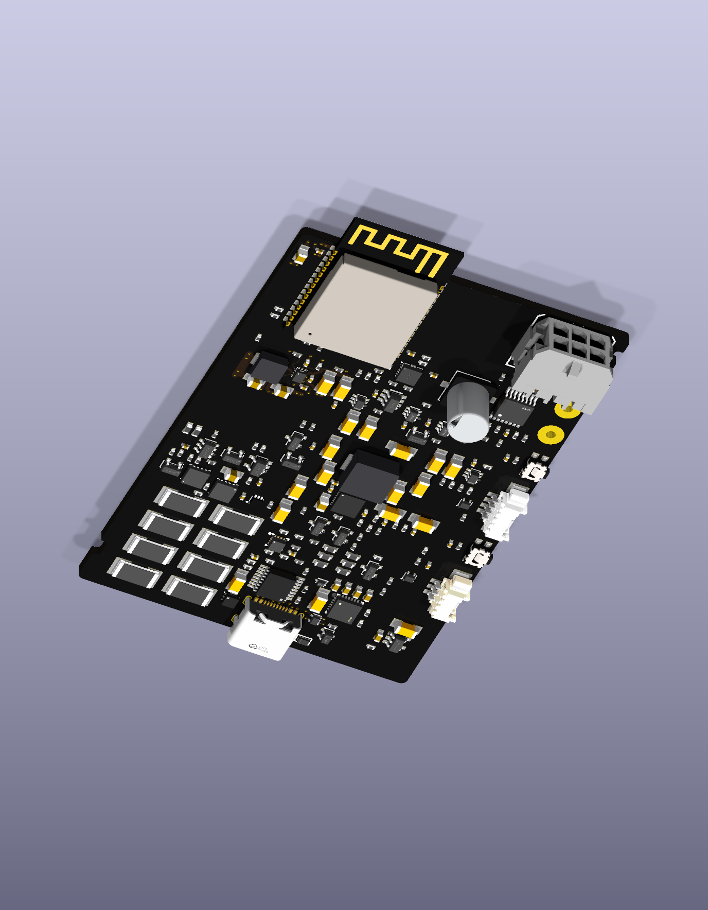

# Local regulator routing

The 54 × 80 mm working board now connects the controller's local 3.3 V regulator
stage. One existing capacitor moves to make room for a separate feedback path;
the board size, 206-part bill of materials, edge connectors and earlier routes
are preserved. This v12 snapshot is still partial: **449 unconnected items
remain**, including the upstream supply to this stage. It is not ready to power
or fabricate.

## What the routing does

The switch-to-inductor path is 2.64 mm long. The separate feedback path reaches
the output capacitor's solder land in 4.71 mm and joins the load path there.
Input bypass, output capacitors, enable, configuration, soft-start and power-good
pull-up connections are present. The intentional open voltage-selection pin
stays isolated. Physical connectivity is checked from intersecting copper and
pad shapes; an equal net name or a future ground plane cannot satisfy it.

All component origins remain on the 0.25 mm grid. New trace vertices use the
0.05 mm grid and horizontal, vertical or 45° segments. Top traces only enter
their declared component pads; they do not transit other component bodies.
Longer supply/control links use the inner layer, with explicit bottom returns.
The ground-reference layer is reserved but has no copper fill yet.

| Actual top copper | Actual inner copper | Actual bottom return |
| --- | --- | --- |
|  |  |  |

These are cropped native KiCad exports, with only the SVG viewport changed.
The revised routes add 86 segments and 14 ordinary through vias, bringing the
board totals to **151 segments and 42 vias**. All 93 previous trace/via items,
eight connector-foot keepouts and the corrected supervisor package are retained.

## Verification and remaining work

The parent review verified 260 frozen source/evidence hashes, independently ran
the saved-candidate geometry analysis, then saved and reopened the board in
isolated Linux KiCad and repeated the analysis on that actual saved file.
Native DRC has no copper-clearance, courtyard, silkscreen or keepout findings.
It retains 449 unconnected items, eight dangling vias, two connector-library
comparisons and three hybrid footprint-type findings.

Eighteen deliberately broken candidate copies are rejected by actual geometry
or connectivity checks, with route-inventory equality disabled. These include
broken supply/return, feedback and control paths, top-layer body transit,
same-net drill intrusion into a solder land, an off-grid via and a removed
connector keepout. The [actual geometry report](v12-actual-geometry.json) and
[fault results](v12-fault-controls.json) record their scope.

The review also identifies improvements still needed. The regulator has narrow
0.15 mm pin escapes and lacks the completed ground/thermal copper called for by
the [TI layout guidance](https://www.ti.com/lit/ds/symlink/tps62902.pdf),
SLVSFM1A pages 41–42. Its 100 nF fast-input loop is compact, but the bulk input
capacitors are farther away; a closer arrangement is being compared without
growing the board. Neither geometric loop area nor a simple copper-resistance
calculation establishes temperature rise, stability or usable load current.

Ground planes, upstream charger routing, complete electrical/thermal review,
startup and radio-burst testing, enclosure cable access and physical qualification
remain unfinished. Actual top, oblique and all three copper views were inspected.
The [checkpoint](v12-checkpoint.json) binds these images to the saved working
board. The canonical fabrication board and automatic gallery remain unchanged.

Earlier frozen passes: [placement comparison](../../trades/2026-10-21-cleaner-main-board.md),
[USB and models](usb-and-models.md), [sparse markings](sparse-silkscreen.md),
[USB data routing](usb-data-routing.md), [controller supply](controller-supply.md),
[supervisor package](supervisor-package.md).

