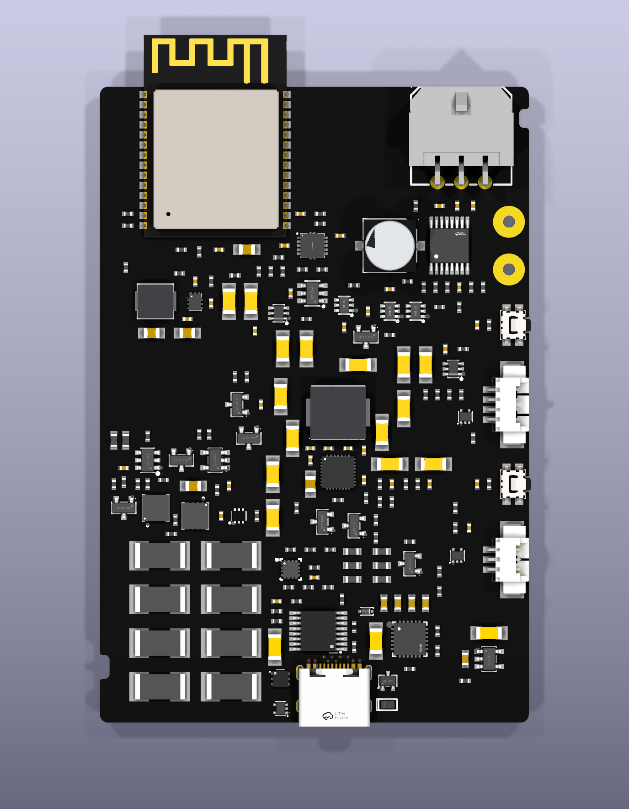
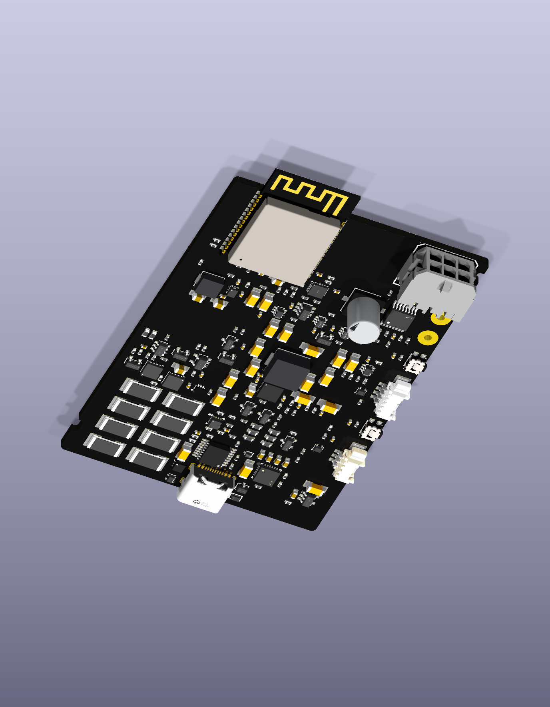

# Cleaner board: sparse markings

The sixth 54 × 80 mm review pass removes decorative white outlines and dots
from 98 resistors and 62 nonpolar ceramic capacitors. All other markings remain,
including the polarized capacitor's signs and semiconductor orientation marks.
Components, models, pads, copper and manufacturing rules are unchanged.

Native top and angled views were inspected after the change. This removes 1,272
graphics, with a full parsed-data comparison proving that only the exact reviewed
silkscreen nodes changed. The edit is scoped by component identity; repeated
graphic IDs on other footprints cannot select an unintended component.

| Native check | Previous pass | Sparse pass |
|---|---:|---:|
| Silkscreen overlaps/spacing findings | 136 | 0 |
| Silkscreen clipped by solder mask | 57 | 8 |
| Silkscreen at board edge | 14 | 14 |
| Footprint type findings | 5 | 5 |
| Footprint-library differences | 4 | 164 |
| Dangling vias | 10 | 10 |
| Unconnected items | 482 | 482 |

The 160 extra library differences reflect the intentional board-only removal;
the corresponding footprint sources must be reconciled before promoting this
study. They are retained as findings, with no severity suppression. Copper and
courtyard clearance findings remain zero. The remaining connector/IC marking
clearances and complete orientation coverage still need review.

This is a partially routed design study. Only the ten initial USB pad-to-via
connections are present. The tidy appearance does not establish electrical,
thermal, enclosure or fabrication readiness. A single board/revision label can
be added when that identity is finalized; component references stay hidden.

[Checkpoint](v6-checkpoint.json) · [Previous model and USB review](usb-and-models.md)

These are frozen review images from local trial sources. The automatic gallery
still renders its registered canonical sources; it does not yet generate this
study. Earlier snapshots remain intact for comparison.
