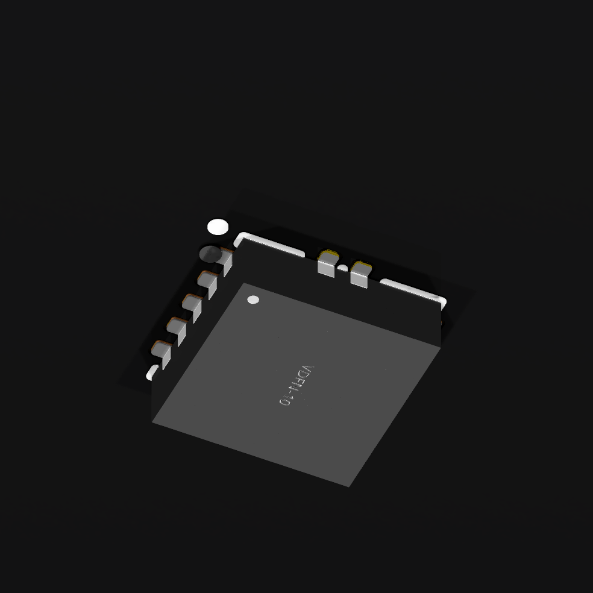

# Supervisor package and model correction

The v11 working board corrects the TPS3430 supervisor's solder lands against
TI's DRC0010J package drawing. Its eleven pin identities and connections stay
the same. All other 205 components, 65 trace segments, 28 vias and eight
connector-foot keepouts are preserved. This remains a partially routed board.

## Copper, mask and paste

The signal lands are now 0.60 × 0.24 mm, with their columns at ±1.40 mm. The
exposed ground land follows the drawing's central area and four extensions,
with no extra polygon stroke. Six separate stencil apertures replace the
automatic full-area paste opening. The mask expansion is 0.05 mm.

| Actual copper | Actual solder mask | Actual solder paste |
| --- | --- | --- |
|  |  |  |

These are native KiCad exports of an isolated single-component review board.
After saving and reopening it, the eleven lands and six paste polygons match
the reviewed geometry within a two-nanometre serialization tolerance. The
isolated board has no DRC violations and three expected unconnected items.
Five deliberately broken geometry or connection variants are rejected.

The measured exposed-pad paste area is 78.75% of its copper area. The smallest
apertures have a calculated area ratio of 0.606 at TI's 0.125 mm stencil
thickness, or 0.631 at the provisional 0.12 mm assembly assumption. These
numbers require stencil-process review; the drawing does not establish
successful paste release for a selected factory process. Ground-plane and
thermal-via connections are still unfinished.

## 3D appearance and clearance

The imported model was only 0.61 mm tall. Its illustrative height is now 0.90 mm,
within the drawing's 0.8–1.0 mm range. Only the vertical scale changes: the
seating datum, horizontal dimensions, orientation and pin-one alignment remain
unchanged. Enclosure checks must reserve the full 3.1 × 3.1 × 1.0 mm maximum
package envelope. This corrected preview remains an imported illustration,
not manufacturer mechanical CAD.

The corrected part and matching local library are also saved in the full v11
working board. Native DRC reports no copper-clearance, courtyard, silkscreen or
keepout violations. It retains **470 unconnected items, eight dangling vias,
two connector-library comparisons and three hybrid footprint-type findings**.
The supervisor library mismatch is resolved. No canonical fabrication board
has been replaced and no hardware has been tested.

The [checkpoint](v11-supervisor-checkpoint.json) records the exact local sources,
native runs and public image hashes. Dimensions come from the
[TI TPS3430 datasheet](https://www.ti.com/lit/ds/symlink/tps3430.pdf),
SBVS366A, package drawing DRC0010J 4218878/B, pages 34–36 of the reviewed copy.
