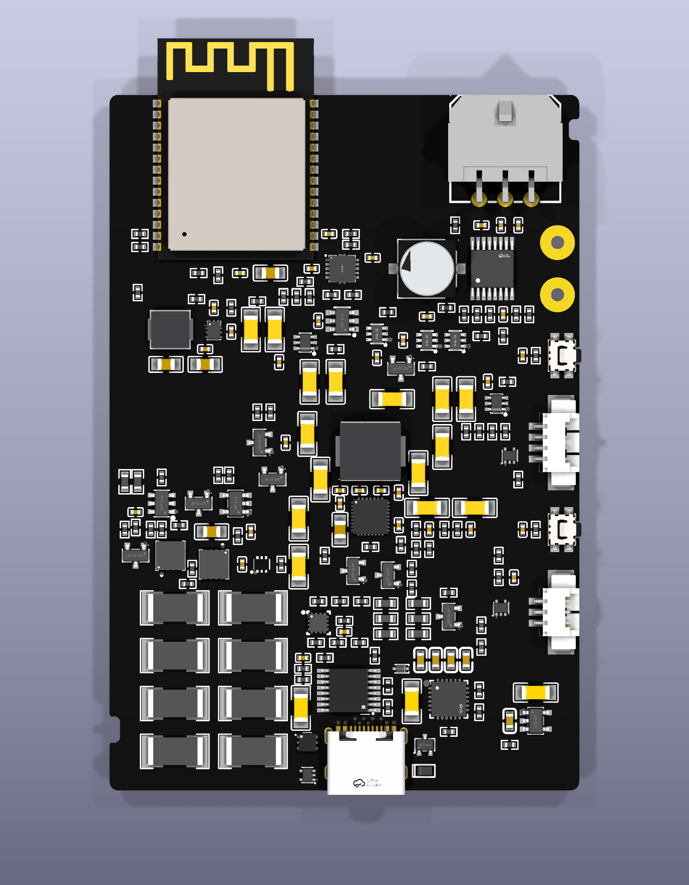
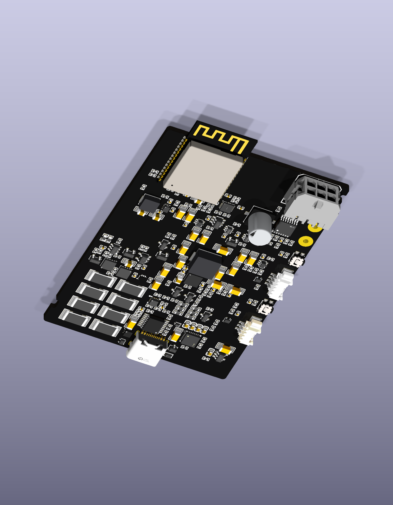
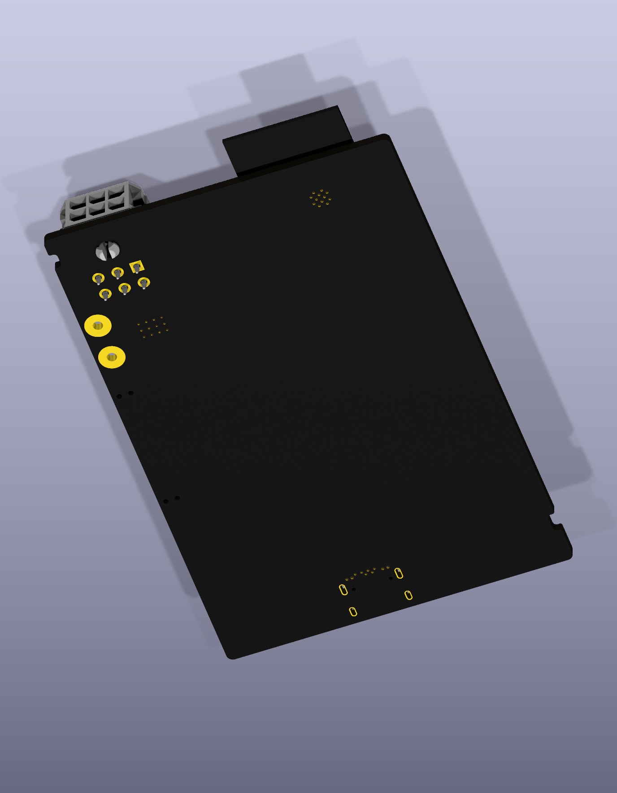
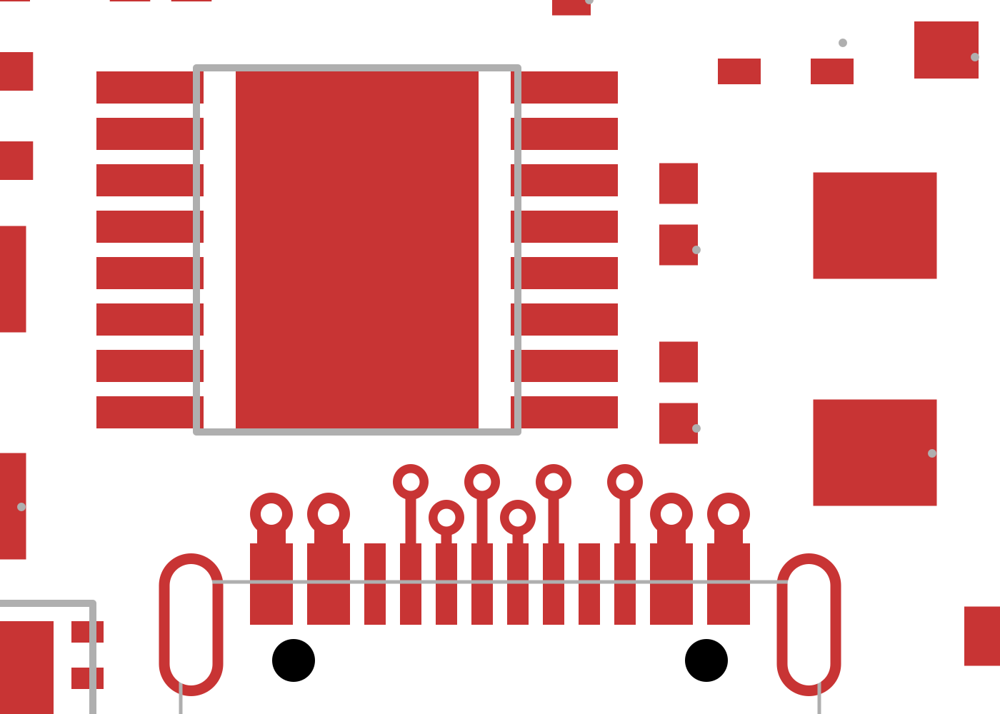

# Cleaner board: first USB escapes and model corrections

The 54 × 80 mm working candidate now has its first ten straight top-layer
connections, each ending at a via. Three local component moves make room for
those parallel exits. The rest of the routing is unfinished; this is a review
snapshot, not a fabrication release.

The battery connector uses a drawing-checked, part-specific STEP model; all six
tails align with their holes and its mouth faces outward. The two inductors now
use drawing-based dimensions and seated terminals. These three model replacements
preserve all non-model PCB data. The native top, angled and underside views were
inspected after importing the exact referenced assets.

The connector CAD came from a public mirror and was checked against Molex drawing
SD-43045-001 revision H; it is not authenticated vendor CAD. Inductor chamfers and
plating appearance are illustrative. Maximum drawing dimensions remain the fit
authority. These views do not establish mating-plug access or manufacturing fit.

## Actual USB copper

This is a cropped viewport of a native KiCad plot, with its geometry unchanged.
Red is top copper and grey is the fabrication outline. All ten traces touch their
actual socket pad and via, leave in parallel and finish on the 0.05 mm grid.
Manufacturer pad centres remain unchanged. No trace passes beneath another
component body in this bounded routed region.

The independent saved-file audit checks every via layer against foreign pads,
including the plated connector shell. Its minimum other-net route gap is
0.175 mm; the minimum drill-edge distance to any SMD land, including same-net
lands, is 0.235 mm. Seven deliberately corrupted board variants are rejected.
The corrected eFuse lands and twelve paste windows are also present.

Native DRC under the unchanged owning project rules reports no copper-clearance
or courtyard violations. **Ten dangling vias, 482 unconnected items and the
existing silkscreen/type/library findings remain.** The USB data rejoin, ESD
returns, power capacity and continuous reference copper are not yet implemented.
In2 is much closer to the bottom layer than to In1 in this saved stackup; any
In2 USB section needs an explicitly reviewed nearby ground reference. A tidy
escape pattern alone is not an impedance or current-capacity result.

[Checkpoint data](v5-checkpoint.json) binds the board, project rules, audits,
model-change record and native images. The earlier v3 snapshots remain intact.
Trial sources still live under local `work/`; these frozen review images are
separate from the automatic gallery's registered canonical designs.
