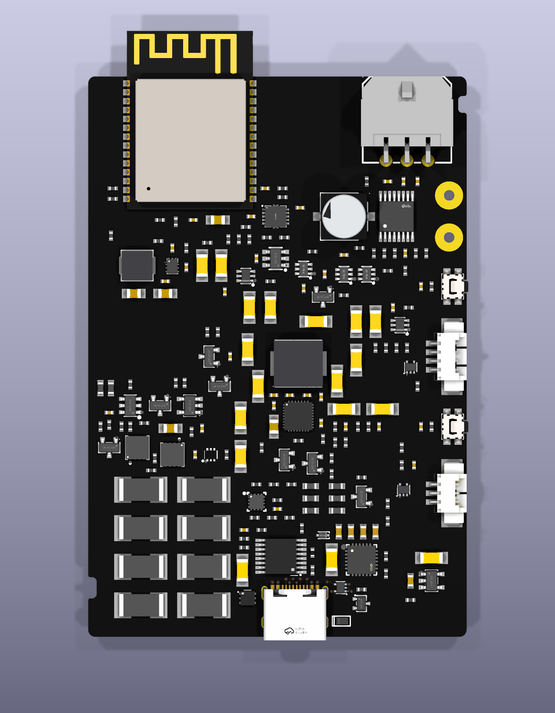
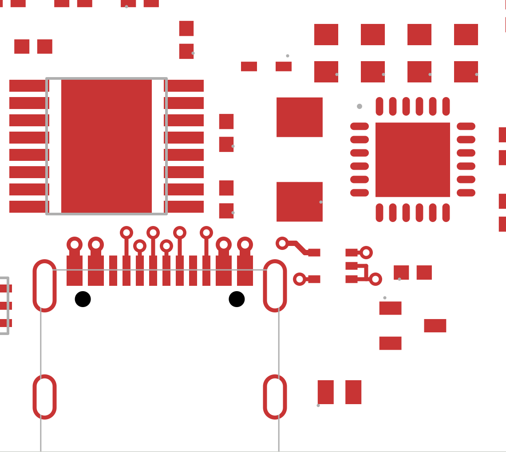
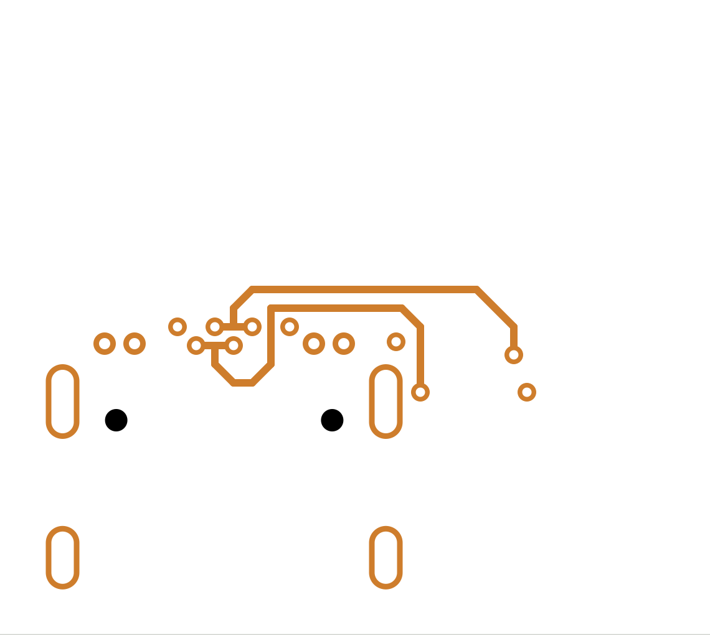
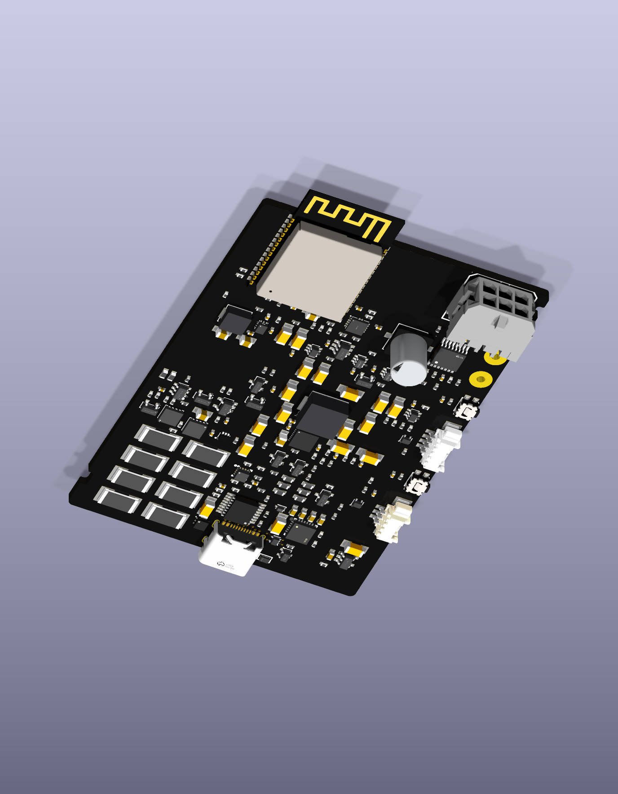

# USB data routing and button placement

This eighth review pass is an actual **54 × 80 mm, four-layer working board**.
It remains a partial routing study, with 35 segments and 14 vias; it is not a
replacement fabrication release for the earlier canonical route.

## Changes since the sparse-marking review

The 160 intentional silkscreen differences are now reconciled with local trial
footprint libraries. That reduces native library-comparison findings from 164
to four without changing the board geometry. The remaining four concern the
reviewed connector, supervisor and eFuse footprint overrides; they remain open.

The complete UP and DOWN switch/filter groups exchange positions. The upper
button now means UP in the inward-facing wall installation. Net identities,
firmware GPIO assignments and the board-wide physical geometry are preserved;
the enclosure's button openings stay in the same places.

Five local USB parts move to bring the data-protection chip beside the socket
escapes. The raw input capacitor remains close to the cutoff input, and the PD
controller moves closer to its local bypass capacitors. The socket, high-voltage
cutoff, eFuse, charger group and mechanical anchors stay fixed. Exact original
pad, net, footprint and existing-copper preimages were checked before applying
the change to the later model/silkscreen/button candidate.

## Actual copper views

The ten original parallel socket escapes are retained. New short top-layer
entries connect the data-protection pads to vias; the longer data routes use
In2. Only the root SVG viewport is cropped below: all copper geometry is native
KiCad output, not an illustrative routing sketch.

The four socket-contact-to-protection paths are each **11.851 mm** in planar
centreline length. This improves the earlier unimplemented 13.644–16.644 mm
option and removes its nominal orientation-dependent mismatch. It does not
prove equal propagation delay: the routes are not uniformly coupled, and the
remaining protected route, reference planes and impedance are unfinished.

The CC-clamp move has an explicit cost: socket-to-clamp pad proximity grows by
2.284 mm on CC1 and 1.278 mm on CC2. Neither CC route is complete. That protection
tradeoff needs review before this option can be accepted as the final USB layout.

The In2 corridor requires continuous B.Cu ground immediately beneath it as well
as In1 ground. The current stackup puts In2 only 0.0994 mm from B.Cu and 1.265 mm
from In1. No ground pours exist yet; the nearby isolated cutoff return must be
kept outside the reserved corridor and its thermal arrangement re-evaluated.

## Native verification and limits

The separate [saved-file geometry audit](v8-actual-geometry.json) checks the
actual 35 segments and 14 vias, rather than only their proposal. It confirms
grid/angle rules, the limited own-pad exceptions to the top-body restriction,
all-layer foreign copper clearance, same-net drill-to-land margins and physical
data/ESD-return connectivity. Seven deliberately broken geometry/topology cases
are rejected. Its [input/output hashes](v8-actual-geometry-freeze.json) were
independently verified before publication. Ground-plane continuity is explicitly
excluded because the saved board has no pours.

The saved board preserves all 206 components and the circuit graph. KiCad reports
no copper-clearance or courtyard-overlap findings. It still reports **477
unconnected items, eight dangling vias, eight mask-clipped silk findings, 14
silk/edge findings, four library comparisons and five footprint-type mismatches**.
The latter include hybrid land patterns and require assembly-aware review.

The first native verification stopped after saving because rotating the CC
clamp reordered unchanged silkscreen line records. Inspection confirmed that
the geometry and identities were preserved. The corrected comparison checks
the complete child multiset after subtracting only the reviewed pose; it retains
every UUID, graphic, pad and property. Verification then continued on the exact
same saved board, without another placement or save. The failed run is retained.

Actual top, oblique and separate copper views were inspected. The black finish,
outward connector mouths, supported USB overhang, rounded outline and sparse
markings remain visible. This inspection does not establish complete routing,
manufacturing tolerance, USB function, surge immunity or current/thermal capacity.

The [checkpoint](v8-checkpoint.json) binds the local working sources, native runs
and published images. These are frozen review snapshots; the automatic gallery
still belongs to the earlier canonical sources. The layout and input-protection
capture need coordinated source/check promotion before replacing that gallery.
