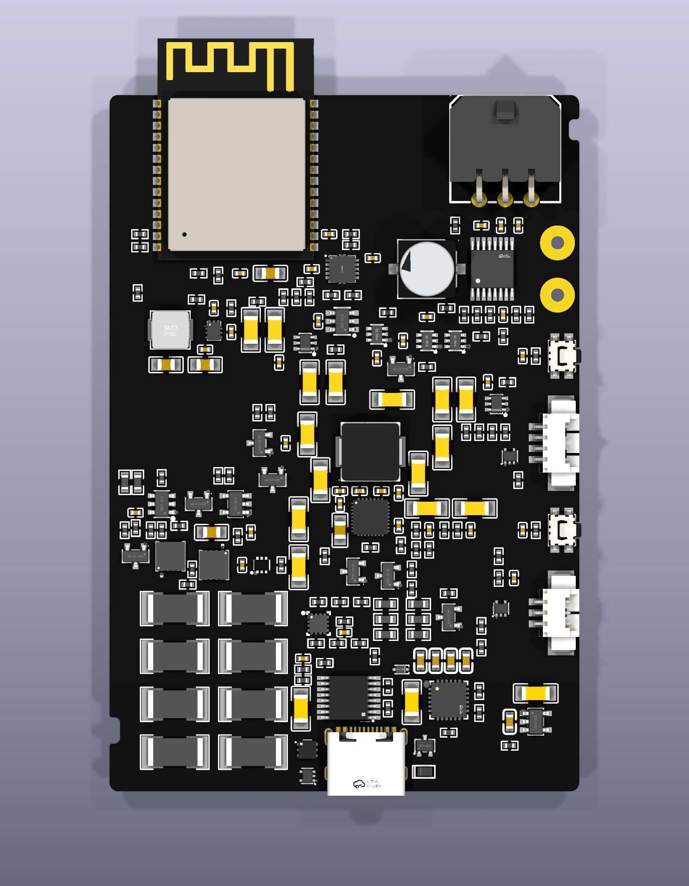
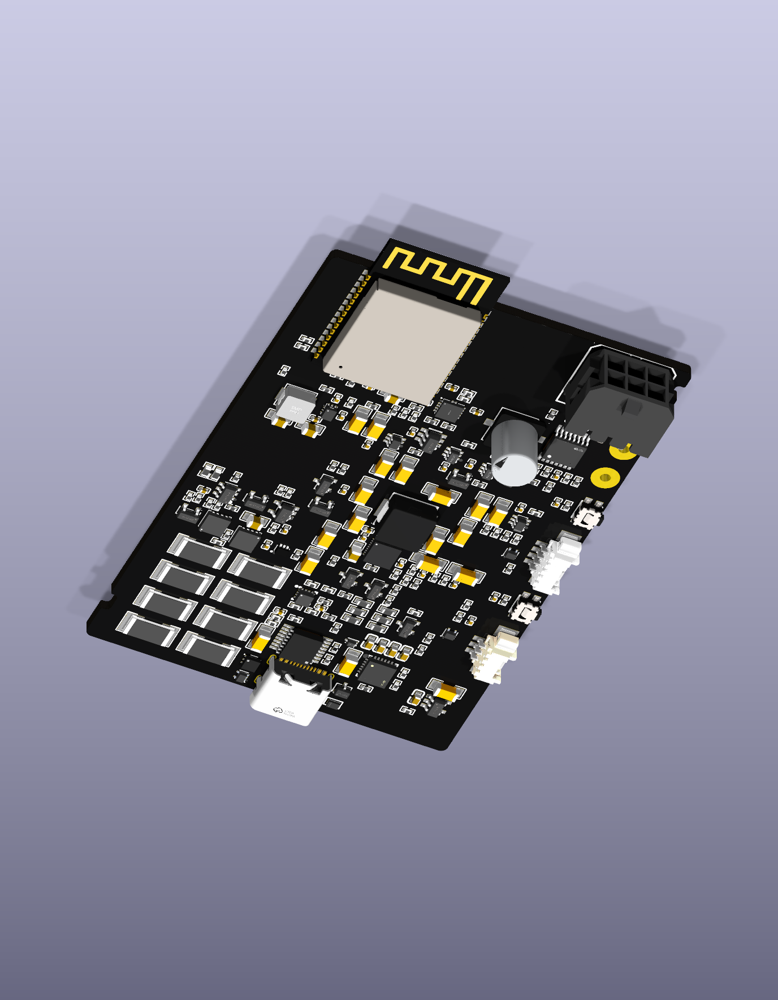

# Trade Study: A cleaner main-controller layout

**Date:** 2026-10-21
**Status:** OPEN

## Context

The owner permits a modest size increase after reviewing the crowded, partially
routed controller. The existing 54 × 68.5 mm board does not meet the requested
[placement and routing rules](../electrical/routing-style.md). The rework keeps
four copper layers and requires outward-facing edge connectors, quarter-millimetre
component origins, 90-degree component rotations, orderly connector escapes,
45/90-degree routing and no top-layer transit beneath component bodies.

These are **unrouted placement studies**, not manufacturing releases. They use
the 206-part input-protection circuit candidate, versus 196 parts in the old
canonical route. All 696 physical pad records and their connection identities
are preserved. The canonical partial route remains unchanged.

## Options

### A: Rework within 54 × 68.5 mm

Keep the existing board envelope. Its current placement has 152 off-grid origins
and its partial route has 387 segments outside the allowed directions. A complete
206-part re-placement and compliant route have not been demonstrated in this size.

### B: Extend to 54 × 80 mm

Keep the width and add 11.5 mm height. The third native placement revision has
206 gridded footprints, outward connector mouths, a clean USB edge and a closed
24-element rounded outline. USB metal overhang is nominally 0.5 mm. Four missing
physical models were added and the motor bulk capacitor model was replaced with
the selected part's nominal 7.7 mm height. Bare motor solder lands have no models.

The images are a frozen review checkpoint; they are not a finished routed board.
[Checkpoint data](../reviews/2026-10-21-clean-layout/checkpoint.json) binds the
board, placement plan, owning rules, native render and independent audit hashes.
The trial board and generation scripts remain under local `work/` while the
study is open. These two review images are snapshots; the automatic gallery
continues to render its registered canonical sources. Register the replacement
source with that pipeline when it is promoted.

### C: Extend to 58 × 80 mm

Add 4 mm width and 11.5 mm height. A 206-part placement fits with no screened
courtyard intersections. Under the current perpendicular-board enclosure
allocation, the extra width increases wall projection by approximately 4 mm.
No routed comparison yet demonstrates that this additional width is needed.

## Comparison Table

| Criterion | A: 54 × 68.5 | B: 54 × 80 | C: 58 × 80 |
|---|---|---|---|
| Board area | 3,699 mm² baseline | 4,320 mm²; +16.8% | 4,640 mm²; +25.4% |
| Gridded 206-part placement | Not demonstrated | Native third revision reviewed | Placement study completed |
| Exact courtyard screen | Existing layout rejected for rework | No intersections in current placement | No intersections in study |
| Proposed case projection | No accepted revised fit | About 74 mm | About 78 mm |
| Routing compliance | Existing partial route fails | Still unrouted | Still unrouted |
| Components and assembly | Earlier 196-part circuit | 206-part circuit candidate | Same 206-part circuit candidate |
| Cost evidence | Historical part inventory | No updated assembly quote | No demonstrated assembly saving |

Case figures are allocation estimates, not complete enclosure acceptance. Final
plug/latch access, wire bends, supports and removal paths remain open. Board area
changes are not equivalent to changes in the total assembly price.

## Recommendation

**Rationale:** continue with 54 × 80 mm as the working candidate. It provides
room for aligned functional groups while avoiding the deeper case associated
with the wider alternative. Keep important switching and bypass paths short;
visual alignment must not extend those loops merely for symmetry.

**What we are giving up:** 11.5 mm board height and 16.8% board area. Actual
enclosure fit and final assembly cost remain to be established. The board is
not accepted just because a placement render looks cleaner.

**When to revisit:** widen or rearrange again if complete routing, USB pad
escapes, continuous ground reference, MCU supply delivery, thermal copper or
cable access cannot meet their requirements. The next routing pass must use
the reviewed corrected eFuse lands; that separate correction is not yet in the
pictured revision.

The final placement audit preserves graph, local pad geometry and planned poses;
all 206 origins satisfy the grid/rotation requirements. All 204 model attachments
resolve, but dimensional/seating review remains incomplete for the battery
connector and inductors. Native DRC under the byte-identical owning project rules
finds no copper-clearance or courtyard violations at this placement stage. It
still reports **482 unconnected items**, 136 silk overlaps, 57 silk-over-copper,
14 silk-edge, five footprint-type and four library-footprint mismatches.

The native save initially rewrote the scratch project to default rules. That
mismatch was caught, preserved, and corrected by restoring the existing project
byte-for-byte after saving. The final DRC and independent audit bind the restored
rules; no clearance rule, severity or exclusion was relaxed.
