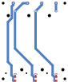

# Experimental companion-carrier route

This is a connected **two-layer routing experiment**, not a fabrication release.
The original carrier under `hw/layouts/blind-pack-companion/` remains the
atopile circuit and placement authority. The routed copy uses native KiCad 10,
35 copper segments, 12 vias, and no copper pours.



Red is outward-face copper; blue is inward-face copper. The companion view is
mirrored horizontally relative to the shared assembly coordinates.

The latest actual KiCad DRC has **zero unconnected items** and no copper,
hole, edge, short, courtyard-overlap or keepout failures. Six inherited
silkscreen findings remain: three at the fuse/board edge and three at holder
holes. Enabling KiCad's normally disabled missing-courtyard check also reports
four errors on the board-only NPTH mounting holes H1–H4. Those exact mechanical
features are retained and reported; all ten purchased-component courtyards are
present and independently checked. The footprint-type check is also explicitly
enabled and passes. No exclusions or waivers were added. `drc.json` retains the
complete report; this is not a zero-error fabrication result.

All severities are requested, but that does not enable disabled categories.
Three unrelated KiCad defaults remain disabled: symbol footprint-filter
matching (no paired native schematic in this derivative), track endpoint
centering on vias, and tuning-profile track geometry. The actual via geometry
and current transitions have separate checks. These defaults are listed in
`checks.json`; none is represented as a passed check.

Only three component placements differ: each nonpolar fuse is rotated 180°,
putting its unfused terminal toward the holder. All physical pin/net identities,
holder positions, mounting holes, outline, wire pads and component sides match
the canonical board. Item UUIDs are made unique so DRC reports identify the
correct physical instances; this does not change copper. New route items are
sorted by their geometry before stable UUID assignment, avoiding KiCad's random
creation-order serialization. Repeated generator runs produce byte-identical
PCB and project files.

The companion's upper support originally prohibited copper on both faces.
The coordinated enclosure change provides a 0.3 mm spacer recess for covered
B.Cu tracks inside local X=9–77, Y=94–97 mm. F.Cu stays bare. Pads, vias, lead
tails, mask openings and copper pours remain forbidden in this window; corner
supports, edge supports and RF restrictions remain intact. The separate
insulating barrier stays in place. Printed fit, tolerance and insulation wear
still need physical qualification.

Long current routes are 3 mm wide; short fanout and unfused links are 2 mm.
The provisional construction is 1.6 mm FR-4 with 1 oz outer copper. Via lands
are 0.9 mm with 0.4 mm finished holes, four per fused branch, tented on both
faces. Every via drill clears every top SMD solder land by at least 0.20 mm,
including same-net lands; an intentional same-net intrusion is rejected. The project rules require 0.25 mm
copper clearance and 0.30 mm edge clearance. These choices fit within the
[JLC capability table](https://jlcpcb.com/capabilities/pcb-capabilities); they
are not a 4 A current or thermal qualification.

From the actual route dimensions, the nominal copper-only loss is about
**0.242 W / 0.121 V** when each companion cell carries 2 A. That assumes equal
sharing with the primary cells and no current in the middle inter-board links.
The 70°C / 20% narrower-track sensitivity gives 0.351 W in the traces alone.
`copper-losses.json` also evaluates unequal and missing-cell cases; it excludes
cells, holders, fuses, solder, inter-board wires, the primary shunt/FETs and
connectors. A 4 A individual branch is a fault/transient planning case, not
approved continuous operation through a 3 A fuse or an unrated holder.

`checks.py` compares actual footprint pads and electrical identities, mounting
features, outline, all retained support/RF areas, reviewed courtyard envelopes,
unique UUIDs and the exact covered-track exception. It also rejects mask
openings in the protected region. Five fault controls move a same-net via into a fuse land, remove a real current
rail, permit a via in the recessed support strip, add a solder-mask opening,
and misattribute a missing-courtyard finding to a purchased component.
The removed rail is rejected by an actual KiCad DRC run, not merely a source
netlist comparison.

Reproduce with KiCad's Python runtime:

```sh
/Applications/KiCad.app/Contents/Frameworks/Python.framework/Versions/3.9/bin/python3.9 hw/routing/blind-pack-companion/route.py
/Applications/KiCad.app/Contents/Frameworks/Python.framework/Versions/3.9/bin/python3.9 hw/routing/blind-pack-companion/checks.py --negative-tests
python3 hw/routing/blind-pack-companion/estimate_losses.py
```

On Linux with KiCad 10 and its distribution Python packages, use
`xvfb-run -a /usr/bin/python3 hw/routing/blind-pack-companion/checks.py --negative-tests`.
Use the same interpreter for `route.py`; the generic setup-python environment
does not supply KiCad's `pcbnew`/`wx` bindings.

Do not pass the routed copy through the canonical placement normalizer, hole
restorer or atopile build. Those tools intentionally own unrouted circuit
captures. `route-record.json` and `checks.json` record the exact source and
mechanical hashes for this experiment.

Remaining work includes silkscreen cleanup, fabrication/assembly review,
controlled pack commissioning, holder/contact heating, fuse interruption,
cell matching/reverse insertion, failed-short protection, retained flexible
raw links and insertion-fixture qualification. No manufacturing outputs or
purchase have been produced.
