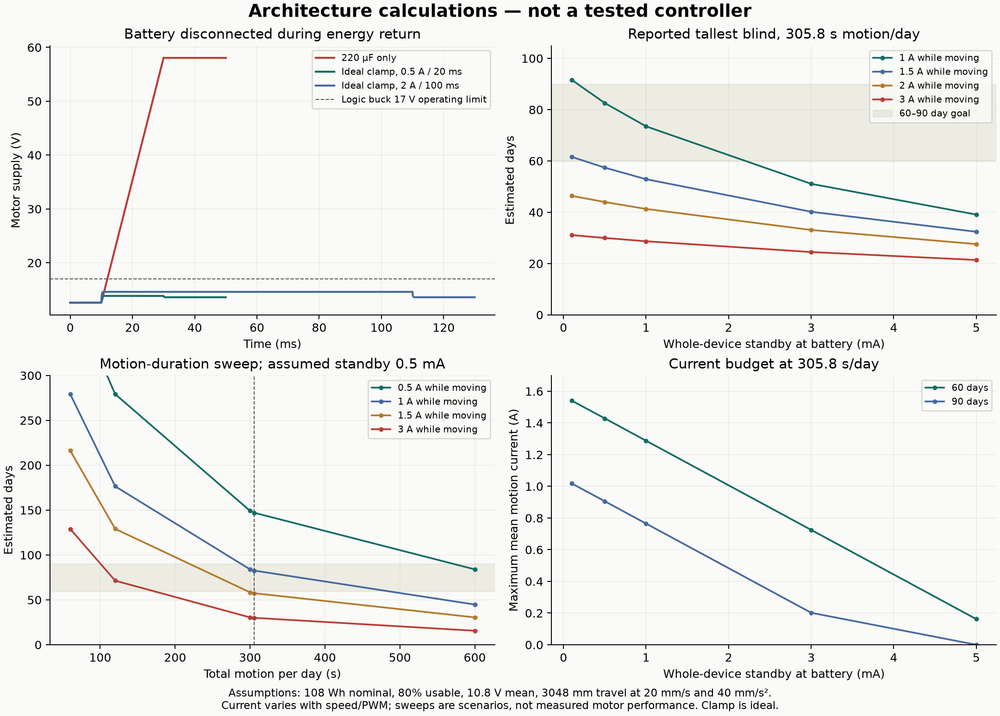
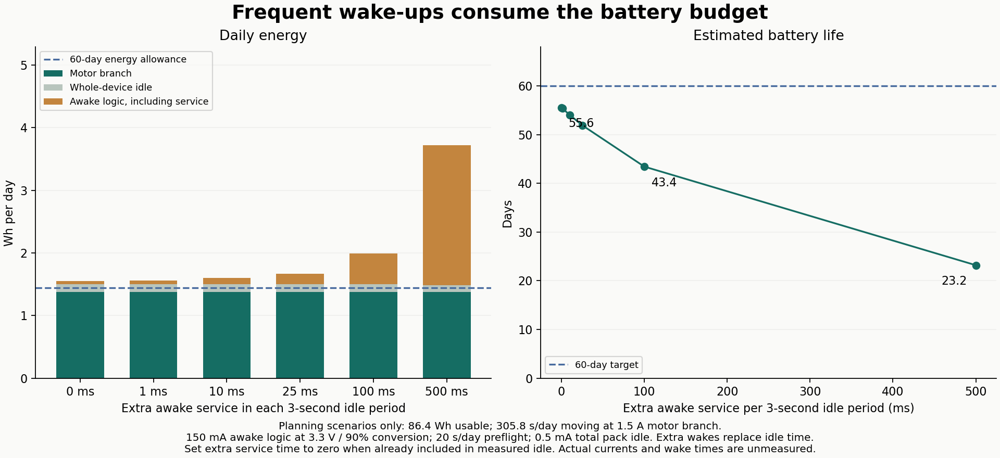

# Electrical envelope checks

These checks test architecture assumptions. They are not a simulated schematic and do not prove the PCB, charging system or purchased motor works.

Run `python3 hw/sim/blind-control/run_checks.py` with ngspice installed. The script checks that each transient reached its requested end time and that all requested measurements exist; ngspice can otherwise exit successfully after a failed analysis. Generate figures with `uv run --no-project --with matplotlib python hw/sim/blind-control/plot_results.py`.

## Energy returned by the motor

An assumed current source models regeneration after the protected battery path opens. A 220 µF capacitor beginning at 12.6 V rises to **58.06 V** for a hypothetical 0.5 A, 20 ms pulse. This is not a prediction of the purchased motor; it demonstrates why a capacitor alone is not an energy-management design. A real motor's current falls as bus voltage rises, so the constant-current stimulus is deliberately conservative and not mechanically self-consistent at arbitrarily high bus voltage.

An ideal clamp at 13.6 V with 2 S conductance holds that case to **13.85 V**, dissipating **0.135 J**. A 2 A, 100 ms stress case with 20% lower capacitance and higher ESR reaches **14.60 V**, with **2.917 J** to dissipate. The real clamp must be selected for pulse energy, sustained load behavior, response time, MOSFET safe operating area and resistor temperature. This simulation does not supply those component ratings.

## Battery life

The arithmetic sweep uses six 5 Ah cells, 3.6 V nominal per cell and 80% usable energy. The [planning profile](../../../docs/electrical/planning-profile.json) uses the owner's reported 3048 mm maximum travel, the coordinator's illustrative 20 mm/s request, and 40 mm/s² acceleration. One full open-and-close cycle takes **305.8 seconds** including the ramps in this ideal trajectory. Actual speed and electrical load remain unmeasured.

The original sweep and figure above use **total battery current while moving**, including controller consumption. At that duration, 1.5 A total moving current and 0.5 mA whole-device standby give about **57.4 days**; 3 A and 3 mA standby give **24.5 days**. Reaching 60 days with 0.5 mA standby requires mean total moving current below approximately **1.43 A**; 90 days requires below **0.91 A**. Do not add MCU/radio power to an already-total measured pack current. The JSON includes 60/120/300/600-second daily motion scenarios and a 10/20/30/50 mm/s travel-time sweep. The earlier 120-second example is only a sensitivity case, not the expected tallest-blind duration.

The separate `split_load_planning` calculation matches the [radio study](../../../docs/firmware/radio-trade-study.md): **1.5 A motor-branch battery-side current**, plus 150 mA awake logic at 3.3 V through an assumed 90%-efficient converter, 20 s/day preflight, and 0.5 mA whole-device idle. This gives **55.56 days**. Its 60/90-day limits are **1.375/0.851 A motor-branch average**. The two calculations use different current definitions; winding current during PWM on-time is neither of them.

Additional battery-powered service work displaces idle time. At the same illustrative 150 mA awake logic current, 10 ms / 100 ms / 500 ms extra awake in each three-second idle period gives **54.05 / 43.44 / 23.19 days**, respectively. Keeping that rail continuously awake gives only **5.93 days**. These are sensitivities, not measurements of the implemented task or evidence that a power-management lock necessarily draws 150 mA. Ordinary radio wake behavior is already included in the assumed idle average; set extra service duration to zero if measured idle already includes the service. Fast polling while externally powered is not assigned a battery-only penalty.

The [planning profile](../../../docs/electrical/planning-profile.json) owns these assumptions. `plot_energy.py` calculates them afresh; CI publishes its PNG, SVG and JSON through the same source-hashed preview workflow as the CAD and PCBs. `test_energy.py` checks the published examples, the full-day phase partition, replacement of idle energy, continuous-awake behavior and invalid inputs.

The proposed continuously powered STUSB4500 is a **component of** the idle budget. ST specifies 140 µA typical / 165 µA maximum at VSYS 3.3 V, disconnected with no communication, under its stated 25°C conditions. At an assumed 85% conversion efficiency this corresponds to **0.0503–0.0593 mA at a 10.8 V battery**, or **0.783–0.922 Wh over 60 full days**. Do not add this again to an already-total 0.5 mA pack-idle figure or to a measured complete awake-logic rail. The remaining idle allowance would be about 0.441–0.450 mA for every other contribution. Active bus traffic, whole-temperature behavior, converter quiescent/light-load efficiency and reverse leakage require measurement. [STUSB4500 datasheet, Rev 8, Table 22](https://www.st.com/resource/en/datasheet/stusb4500.pdf).

Pack current changes with PWM duty, speed, torque and battery voltage. Sweeping current and duration independently does not model those couplings or show that a faster motor consumes less energy. The reported 5 lbf peak pull is not average force, so it cannot establish a cycle-work lower bound without a force-versus-travel measurement. No 60–90 day lifetime is demonstrated. Self-discharge, aging, temperature and extra adjustment moves are unmeasured.

## Manufacturer model investigation

TI publishes a [DRV8874 PSpice transient model](https://www.ti.com/lit/zip/SLVMCX0) and [datasheet](https://www.ti.com/lit/ds/symlink/drv8874.pdf). The model was downloaded and inspected locally without redistributing it. Its notes exclude thermal operation, quiescent current and charge-pump operation.

The unmodified TI model initially aborted in ngspice 47 PSpice compatibility mode with a timestep error. Gear integration and small node capacitances allowed completion, but the hypothetical stalled-load test produced approximately 1.74 A with effectively zero current-feedback output. Its embedded current-gain parameter is 500 µA/A, versus 450 µA/A in the current datasheet. **This is an unresolved simulator/model compatibility result, not a passing driver validation.** Do not adjust the model merely to match desired numbers. Validate this manufacturer model with its intended PSpice environment or independently verify a documented port before relying on its current regulation results.

The charger, gauge, regulator startup, NTC faults, actual motor/encoder, PCB parasitics, RF and thermal behavior remain untested. The generated JSON records simulation version and template hash; plots show only the independently reproducible energy cases above.
